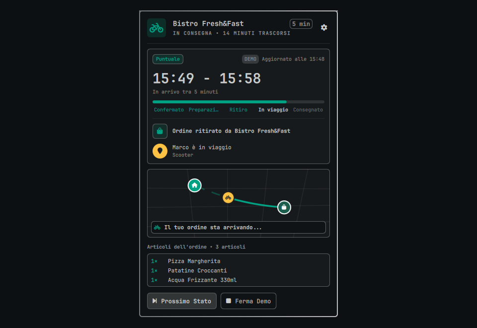

# Glovo Tracker for Omarchy

Track your live Glovo delivery orders directly from the Omarchy status bar with an ETA pill, phone-style delivery popup, route map, desktop notifications, and progressive stage chimes.



## Features

- **Status bar pill**: displays the active order icon and live ETA countdown (or optional hide-when-idle mode).
- **Phone-style delivery popup**: shows order stage timeline (`confirmed` → `preparing` → `pickup` → `delivering` → `arriving` → `delivered`), delivery ETA window, store & courier messages, order items, and an animated route map.
- **Standalone PC browser session (no phone required)**: sign in once to Glovo in a dedicated local Chromium profile, then sync active orders automatically at a configurable interval (off by default until enabled in Settings).
- **Optional Flux phone sync & manual API token**: reads local Glovo notifications forwarded by `fluxd`, or queries `https://api.glovoapp.com` directly with a saved bearer token, or watches a local JSON bridge file at `~/.local/state/omarchy/glovo-tracker/order.json`.
- **Progressive food-themed notification chimes**: warm ascending `.oga` tones that rise with each delivery stage, a celebratory resolution chime on delivery, and a soft descending tone if cancelled.
- **Built-in Demo mode**: preview all delivery stages and sounds directly from Settings without placing an order.
- **Live translations**: supports English (`en`) and Italian (`it`) via `Commons.Translations` without restarting the shell.

## Install

```bash
omarchy plugin add https://github.com/Carloj005/omarchy-glovo-tracker --enable
```

## Remove

```bash
omarchy plugin remove io.github.carloj005.glovo-tracker
```

To also delete locally saved session, auth token, and browser profile data:

```bash
rm -rf ~/.local/state/omarchy/glovo-tracker
```

## External Dependencies

All required tools run with normal user permissions; no privilege elevation is required.

- **Node.js 22+ (`node`)**: runs `bin/glovo-session.cjs` using built-in `fetch` and anonymous pipe IPC (no npm packages required).
- **Chromium (`chromium`)**: required only for the optional standalone PC browser login and headless background sync (communicates over private anonymous pipes via `--remote-debugging-pipe`, with no TCP ports opened).
- **`paplay`** (PulseAudio / PipeWire): plays the bundled `.oga` stage notification chimes.
- **`omarchy-notification-send`**: ships with Omarchy for desktop notifications.
- **Flux (`fluxd`)** *(optional)*: only needed if you enable phone notification sync.

## Usage

| Action | How |
|---|---|
| Open / close popup | Left-click the bar icon |
| Refresh order (or advance step in Demo mode) | Middle-click the bar icon |
| Send current status notification | Right-click the bar icon |
| Open Settings, Demo Mode, or Sound Preview | Click the gear icon inside the popup |

### IPC Commands

```bash
omarchy-shell io.github.carloj005.glovo-tracker toggle
omarchy-shell io.github.carloj005.glovo-tracker refresh
omarchy-shell io.github.carloj005.glovo-tracker login
omarchy-shell io.github.carloj005.glovo-tracker sync
omarchy-shell io.github.carloj005.glovo-tracker logout
omarchy-shell io.github.carloj005.glovo-tracker startDemo
omarchy-shell io.github.carloj005.glovo-tracker nextDemoStep
omarchy-shell io.github.carloj005.glovo-tracker stopDemo
omarchy-shell io.github.carloj005.glovo-tracker testSound sequence
```

## Privacy & Security

- **Explicit network endpoints**: network requests are restricted to `https://glovoapp.com` and `https://api.glovoapp.com` with strict timeouts and response-size caps (`256 KiB`).
- **No local TCP debugging ports**: headless browser sync communicates with Chromium strictly via inherited anonymous pipes (`--remote-debugging-pipe`), never opening a loopback or network TCP listener.
- **No tokens in process arguments**: credentials are delivered over `stdin` when saved and read directly from the `0600` `auth.json` file during API requests, never passed via command-line arguments (`/proc/<pid>/cmdline`).
- **Preemptive sign out**: signing out immediately cancels active sync/polling, preempts any in-flight `glovo-session.cjs` lock holder, disables background sync/polling, and removes the saved profile and token (surfacing an explicit UI error if sign out fails).
- **Opt-in background sync**: both automatic browser session sync (`browserSyncEnabled`) and API polling (`autoRefreshEnabled`) are disabled by default and clearly disclosed in Settings.
- **Owner-only atomic local state**: credentials, session state, and the isolated Chromium profile live in `~/.local/state/omarchy/glovo-tracker/` (`0700` directory, atomic `0600` files created with `O_EXCL`).
- **Untrusted input hardening**: all external text is neutralized against HTML/QML markup and rendered through `Text.PlainText` (`PlainText.qml`).

## Tests

```bash
node tests/test_model.js
omarchy plugin validate .
```

## License

[MIT](LICENSE)
